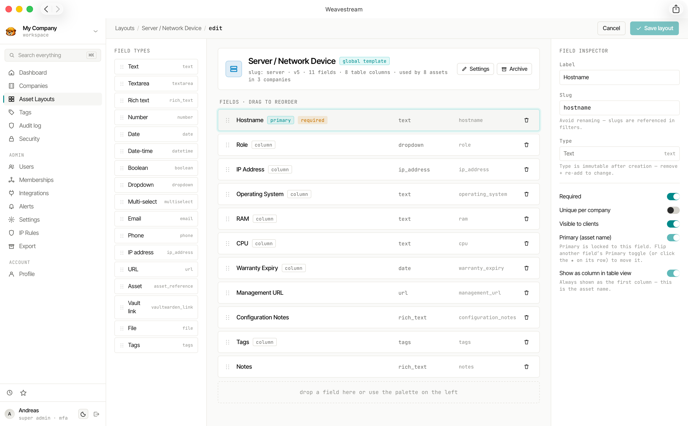

# Asset Management

Weavestream's asset system lets you build structured records for any kind of infrastructure. You define the fields, and every tenant's assets conform to that schema.

## Asset Layouts

An **Asset Layout** is a global template — think of it as a form definition. Each layout has a name, an optional icon, and a list of fields. Layouts are managed by `SUPER_ADMIN` users and shared across all tenants.

Examples of layouts you might create:

- **Server** — hostname, IP address, operating system, CPU, RAM, warranty expiry
- **Workstation** — assigned user, serial number, purchase date, warranty date
- **Software License** — product name, vendor, seat count, license key, renewal date
- **Network Device** — make, model, firmware version, management IP, location
- **SSL Certificate** — domain, issuer, expiry date, notes

### Layout management

- **Rename** layouts in place without affecting existing assets
- **Archive** layouts to hide them from the creation picker while preserving historical records
- **Drag-and-drop** field reordering within the layout builder
- **Sidebar sections** with custom positioning for grouping related fields

## Field Types

Each layout can contain any combination of the following field types:

| Type | Description | Notes |
|---|---|---|
| `TEXT` | Single-line plain text | — |
| `TEXTAREA` | Multi-line plain text | — |
| `RICH_TEXT` | Tiptap rich-text editor | Tables, images, code blocks |
| `NUMBER` | Numeric value | — |
| `DATE` | Calendar date | Supports expiry tracking |
| `DATETIME` | Date and time | Supports expiry tracking |
| `EMAIL` | Email address | Renders as `mailto:` link |
| `PHONE` | Phone number | — |
| `URL` | Hyperlink | — |
| `BOOLEAN` | Yes / No toggle | — |
| `DROPDOWN` | Single-select from predefined options | Optional free-text "Other…" escape hatch |
| `MULTISELECT` | Multiple selections from predefined options | Drag-and-drop option reordering |
| `IP_ADDRESS` | IPv4 or IPv6 address, optional CIDR | Groundwork for IPAM |
| `FILE` | Document or image upload | — |
| `ASSET_REFERENCE` | Cross-link to another asset | Creates a `Relation` record |

## Field Options

Each field supports additional configuration:

| Option | Description |
|---|---|
| **Primary field** | Highlighted in list and table views |
| **Show in table** | Controls column visibility in asset list tables |
| **Visible to clients** | Whether the field appears in the client portal |
| **Expiry tracking** | `DATE` and `DATETIME` fields — enables countdown and colour-coded status |
| **Unique per company** | Enforces uniqueness of the field value within a tenant |

## Asset Records

Each **Asset** is a single instance of a layout within a tenant. Assets support:

- **Soft-archive** — remove from active lists while preserving the full historical record
- **Permanent deletion** — requires the asset to be archived first; this is enforced server-side for both single and bulk purge, and purging additionally requires step-up re-authentication. Bulk purge skips still-active assets and reports them so you can archive and retry
- **External ID tracking** — for synchronising with external systems
- **Embedded passwords** — link credentials directly to an asset; they archive when the asset is archived
- **Cross-references** — `ASSET_REFERENCE` fields create navigable links between assets

## Copying and Moving Assets

Copy an asset into another company (or duplicate it in the same one) from the asset's **⋯ → Copy to company…** menu, or select several in the asset table and use **Copy to…**. Tick **Move** to archive the originals after copying: they are archived, not deleted, so they can be restored.

Asset layouts are global, so a copy keeps its layout and every field value you can see, handled as follows:

| What | In the copy |
|---|---|
| **Files** (fields and the attachments panel) | Copied into the target company's storage as new files; a deleted file is skipped. A file whose stored content is missing is not copied: the copy is reported as incomplete, and a move keeps the original. A missing thumbnail does not block the copy |
| **Linked assets** | Dropped when the company changes; they point at the source company's records. Same-company copies keep links whose target still exists and omit dead ones. A *required* link field blocks a cross-company copy |
| **Tags** | Copied. Old tag values the asset page does not show (from before tags became global) are left out |
| **Linked passwords** | Not copied; they stay with the original |
| **Hidden fields** you cannot see | Not copied |
| Integration identity (external id) | Not copied; the copy is a hand-managed asset |

**Move** is refused, with the reason, when it would lose or undo something: the asset is kept in sync by an integration (the next sync would restore the original), it has linked passwords (they would be archived with it), or some of its fields are hidden from you. Copy it instead in those cases.

Copying needs read access to the source company and write access to the target; moving also needs archive access to the source. Read-only users can select several assets in the table to copy them; archive, restore and delete stay hidden. If a bulk run fails part-way, the assets already copied are removed from the selection, so a retry copies only the rest. A field marked *unique per company* that is already taken in the target makes that copy fail with a clear message; the other copies in a bulk run still go through. Each copy is audited (`asset.clone`, plus `upload.copy` per file).

## Expiration Tracking

`DATE` and `DATETIME` fields with expiry tracking enabled appear in the global **Expirations** dashboard (`/admin/expirations`). Cells are colour-coded:

- **Green** — within a healthy window
- **Amber** — approaching expiry
- **Red** — expired

This lets you surface warranty expirations, license renewals, and certificate deadlines across all tenants at a glance.

### Dismissing items

Every row on **Expiring soon** (global and per company) has a **Dismiss** button, with an optional note such as "client cancelled, letting it lapse". A dismissed item:

- disappears from Expiring soon, stops sending expiry alert emails, and stops counting on the dashboard's domain alerts (unless the domain is also listed there for a low score);
- applies to **that due date only**. If the date changes, for example a renewal that later lapses again, the item shows up again;
- changes nothing about the asset, domain or password itself.

Use **Show dismissed** to see dismissed items with their note, and **Restore** to bring one back. Dismissing needs the same permission as managing the item (`domain.manage`, `asset.write`, or `password.write` plus access to that password), and every dismiss and restore is in the audit log.

## Search

Asset lists search names and indexed field values, including text, choice labels, numbers, stored dates and date-times, file names, and tag names. Boolean values, asset-reference targets, and Vaultwarden links are not indexed. Client users search only fields visible to clients.

Type a term and press **Enter** to add a search pill, then add more terms to narrow the list. Every term must match; words within a term may match different fields. Matching is case-insensitive and uses literal substrings, so `%` and `_` are ordinary characters. Remove a pill with its **×**, use **Backspace** in an empty search box to remove the last term, or choose **Clear all** to reset the filters. A search supports at most **10 distinct terms**, each with at most **8 words** and **200 characters**.

The company Assets page also accepts `field.<slug>=<value>` URL filters. Text values are trimmed and matched case-insensitively; dropdowns accept a choice label or slug. Numbers and booleans match by value. Without a layout filter, a field slug matches across all layouts that use it. Invalid fields, values, or search limits show a **Filter not applied** banner and keep the filter pills available for removal.

The same indexed text supports full-text search via the [command palette](/features/search/) and the search API. Results are scoped to the requesting user's accessible tenants.

## CSV Export

On a company's layout list in the admin interface, open **Export** and choose:

| Choice | Contents |
|---|---|
| **Visible columns (CSV)** | Name, layout fields marked **Show in table** (except the primary field already represented by Name), Updated, and Archived at when archived records are included |
| **All fields (CSV)** | Name, every readable non-primary layout field, ID, Created, Updated, and Archived at |

Export requires asset read access; read-only staff can use it. The client portal has no Export control. Both choices omit archived fields and Vaultwarden links. Files export as names, references as asset names where available, tags and choices as labels, and rich text as plain text. Timestamps use ISO format.

The CSV follows the list's committed search terms, archive toggle, and tag filter. It exports up to **5,000 rows** in the list's default order, applying the tag filter after that cap, just as the page does. Local column sorting does not change the CSV order. When the base list exceeds the cap, a warning asks you to narrow the search. Cells that could be interpreted as spreadsheet formulas are escaped, and every download is audited as `asset.export`.

The API endpoint is `GET /api/v1/companies/:companyId/assets/export`, with required `layout=<uuid>`, optional repeated `q`, `includeArchived=true`, `tag=<uuid>`, and `columns=table|all` (default `table`). It allows 10 requests per minute and returns `X-Export-Truncated: true` when capped.
