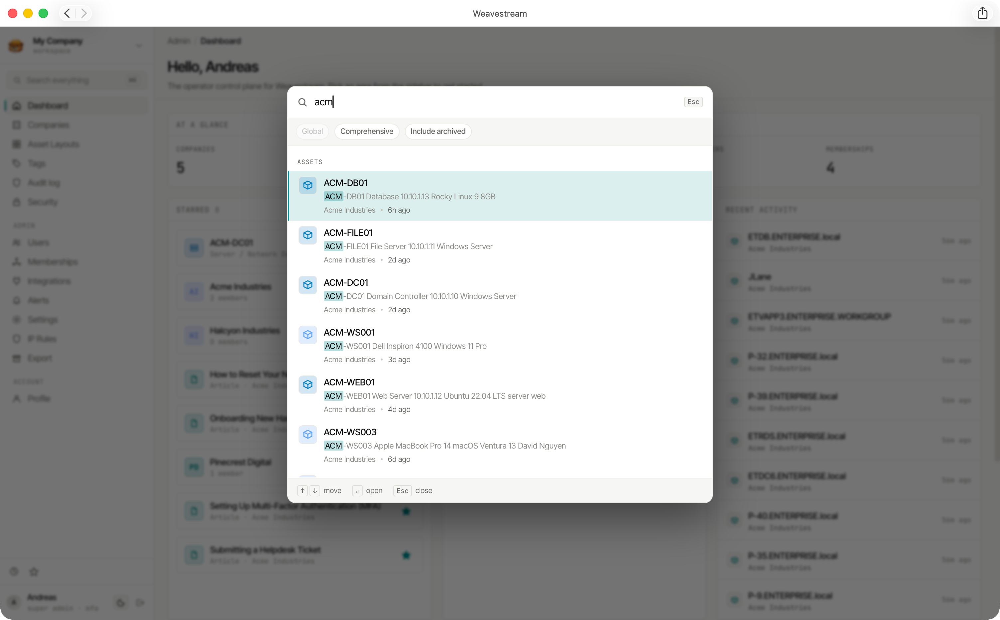

# Search

Weavestream provides full-text search across articles, assets, passwords, domains, and uploads, backed by PostgreSQL's native `tsvector` indexing.

## How It Works

A denormalised `SearchIndex` table maintains indexed documents for searchable entities. Asset writes rebuild their index rows inside the write transaction; database triggers maintain article and upload rows. Changing dropdown or multiselect choices, hiding or removing a layout field, or renaming or deleting a tag also rebuilds the affected asset rows.

Each index record stores:

- A plaintext representation of the content
- A `tsvector` blob (pre-computed by Postgres)
- Field weights (title: A, body: B)
- Entity type, ID, and tenant scoping

Queries run against the `tsvector` column with GIN indexing for fast lookups.

## Scope & Visibility

Search results are always **scoped to the requesting user's accessible tenants**. A user cannot find records from a tenant they are not a member of. Additionally:

- Fields marked `visibleToClients=false` are stripped from client portal results
- Archived entities are excluded from search results
- Password entries follow their own internal-access list, then the active company membership override, then the global password access policy. Attachments of entries an internal user cannot open are hidden too. See [Password access restrictions](/features/passwords/#access-restrictions).

## Command Palette

Press **Cmd+K** (macOS) or **Ctrl+K** (Windows/Linux) anywhere in the admin interface to open the command palette.

The command palette searches across:

- Articles
- Assets
- Companies (tenants)
- Password entries (metadata only)
- Domains
- Uploads

### Per-user toggles

Each user can configure the command palette behaviour from their profile:

| Toggle | Options |
|---|---|
| Scope | Current tenant only / All accessible tenants |
| Depth | Recent items only / Comprehensive search |

## Indexed Content

| Entity | What is indexed |
|---|---|
| Articles | Title and body text |
| Assets | Name and searchable field values: text, choice labels, numbers, stored dates/date-times, file names, and tag names. Boolean values, asset-reference targets, and Vaultwarden links are excluded |
| Uploads | Filename and attached notes |

Rich-text content (Tiptap JSON) is converted to plaintext before indexing.

## Asset List Search

The company Assets page and per-layout lists use case-insensitive substring matching against the asset name and indexed fields. Press **Enter** to stack search terms as removable pills; every term and every word within it must match, but words may occur in different fields. These list searches use literal characters rather than the command palette's full-text query rules. See [Asset search](/features/assets/#search) for limits and field-filter behavior.

## Refresh After Upgrading

Migration `0089_asset_search_reindex` queues an automatic rebuild for existing assets so newly searchable numbers, dates, file names, and tag names become discoverable. The API runs an early pass in the background; the updated worker runs the final pass and logs **Asset search text refreshed (final pass)**. Keep both services updated. A failed refresh keeps its marker and retries on the next start; no manual command is normally required.

If a layout or tag change commits but its search rebuild fails, the server logs the failure and the request reports an error. An administrator can run the `reindex-search` CLI command to rebuild the index. In particular, a failed rebuild after hiding a layout field can leave old client-visible search text until it is repaired.
