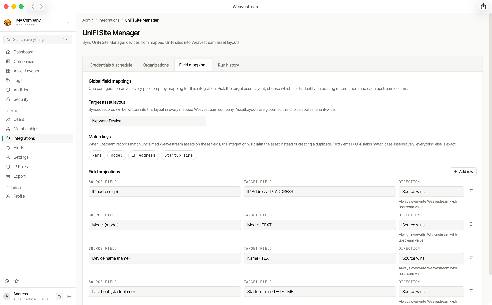

# Integrations Overview

Weavestream's integration layer synchronises asset and infrastructure data from third-party platforms directly into your tenant asset records. A shared sync orchestration engine handles scheduling, conflict detection, field mapping, and error reporting — each provider is implemented as a dedicated driver on top of that foundation.

## Architecture & How It Works

1. **Configure Provider Connections**  
   Operators supply credentials (API tokens, OAuth2 client secrets, service principal keys, or controller URLs) and map source organisations or sites to target Weavestream companies. OAuth providers (Google Workspace) have one integration per install: its **App** tab holds the OAuth app and its **Connections** tab one connection per customer tenant.

2. **Sync Orchestration**  
   Sync jobs run on demand or on a configurable schedule (via UTC cron expressions). The background worker invokes the provider driver to fetch source records, apply field transformations, and upsert records into Weavestream asset layouts.

3. **Review & Monitor**  
   Every sync run records granular status, last-seen timestamps, processed record counts, safe gap reports, and audit trail events on the integration detail page.

## Core Sync Behaviours

- **Upsert Engine** — Records are created on first sync and updated on subsequent runs based on the provider's unique identifier.
- **Soft Staling (No Deletion)** — Records removed or unseen in upstream platforms are flagged as stale rather than deleted, preserving full historical integrity.
- **Granular Audit Log** — Sync runs, field changes, and status transitions write append-only records to the platform audit log.
- **Integration Sections**: A driver can attach a read-only detail card to each synced asset (grouped values, usage bars, links). It appears on the asset page with the driver's logo and the last sync time, is replaced on every sync, and is never shown to client users. Section values are not searchable yet.
- **Map Layouts and Match-first**: Drivers that suggest layout matches add a **Map layouts** tab: pick the layout for each kind of record (or create a new one, or skip it) and the field to match on. On sync, a record whose match value equals exactly one unlinked, manually created asset adopts that asset instead of creating a duplicate; two or more candidates are reported on the run and nothing is linked. New assets get only their name and match value; everything else goes in the integration section.
- **Several Integrations on One Asset**: see [below](#several-integrations-on-one-asset).
- **Unavailable resources are skipped**: when a tenant cannot provide a whole resource (for example devices it is not licensed or permitted to read), that resource is skipped with a warning on the run. The run still succeeds, the other resources sync, and assets already linked to the skipped resource are left exactly as they are (never marked stale or archived).
- **SSRF & Egress Protection** — Outbound integration requests pass through Weavestream's safe fetch layer to guard against SSRF, DNS rebinding, and unauthorized private network access.

## Several Integrations on One Asset

One real person or device is one asset, even when several integrations know it (for example a laptop in both Level RMM and NinjaOne).

- **Match-first links to assets other integrations created.** When no asset you created yourself matches, a record whose match value (email, serial number) equals **exactly one** asset that another integration already syncs joins that asset instead of creating a second one. Text matching ignores upper and lower case. The asset keeps its name and stays owned by the integration that created it; the asset page shows one section per integration. Two or more matches are reported on the run and nothing is linked. An asset is never shared with another record of the same integration, and assets from integrations that do not fill layout fields (Action1, NinjaOne, UniFi, Breeze) are never shared.
- **A priority order decides whose values win.** Under **Admin > Settings > Integrations**, drag the integrations (or use **Up** and **Down**) into the order whose values should win. For each standard field, the highest integration that has a value fills it, following the usual rules (your own edits are never overwritten). A lower integration only fills a field while it is empty; when its value differs, it is listed as a difference in **its** section ("Google Workspace value" next to the Weavestream value) with **Use <source> value** and **Keep ours**, and on its **Differences** tab. A value one integration does not have never clears what another provides. A new order applies from each integration's next sync. Saving the order needs the settings permission and a fresh MFA step-up, and is audited.
- **Use <source> value from a lower integration** writes that value once, like an edit of yours: the higher integration does not overwrite it, and lists its own value as a difference instead. To make a lower integration win for good, move it up the order.
- **Default order:** Level RMM, NinjaOne, Action1, Breeze, Google Workspace, UniFi, Cloudflare, then any other integration.
- Domains are not affected: they are matched by name in Domains monitoring.

## Available Integrations

Select an integration below for provider-specific setup guides, resource capabilities, and field mapping details:

[!card title="Action1" text="Import Windows endpoint records and system hardware telemetry from Action1 RMM into tenant asset records." icon="plug" layout="compact"](/integrations/action1/)

[!card title="Breeze" text="Read-only reconstruction sync for durably importing organization structures, devices, configurations, and topology." icon="plug" layout="compact"](/integrations/breeze/)

[!card title="Cloudflare" text="Manage Zero Trust Gateway IP lists with drift repair, and sync every domain on the account into Domains." icon="plug" layout="compact"](/integrations/cloudflare/)

[!card title="Google Workspace" text="One-click connect per customer to sync users, licences, storage, groups, domains and devices (read-only)." icon="plug" layout="compact"](/integrations/google-workspace/)

[!card title="Level RMM" text="Sync Level RMM devices per top-level group: hardware, OS and network facts fill your layout fields; status, storage, security, patches and alerts show on the asset (read-only)." icon="plug" layout="compact"](/integrations/level/)

[!card title="NinjaOne" text="Sync agent-managed workstations, servers, SNMP network gear, and guest VMs with dual-resource mapping." icon="plug" layout="compact"](/integrations/ninjaone/)

[!card title="UniFi" text="Import Ubiquiti UniFi network gateways, switches, access points, and connected client devices into asset records." icon="plug" layout="compact"](/integrations/unifi/)
